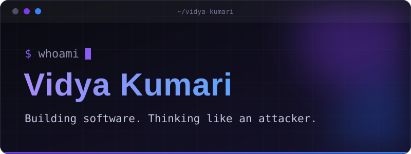
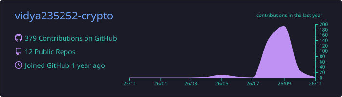
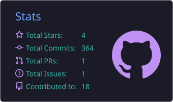
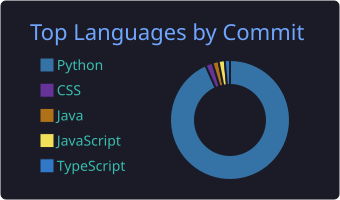
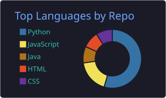
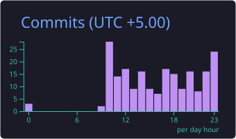

<!--
  CUSTOMISING THIS README
  - Colours used everywhere: #8b5cf6 (purple), #3b82f6 (blue), #161b22 (charcoal), #0d1117 (black)
  - Search for "TODO" to find every placeholder.
  - Images in ./assets are hosted in this repo, so they never depend on third-party servers.
-->

<div align="center">



<br />


<br />


</div>


## `~/about`

I'm an Information Science and Engineering student at **Dayananda Sagar College of Engineering, Bengaluru**. I build full-stack projects in Python and FastAPI, and I'm most interested in the part of software people tend to skip: how it breaks, and how to catch that early.

I learn by shipping something, attacking it with tools like Burp Suite and PortSwigger labs, and writing up what I found on my blog. I'm an **ACM member** and take part in the campus tech community.

```yaml
# vidya.yml
name:      Vidya Kumari
studying:  B.E. Information Science & Engineering @ DSCE (2024-2028)
building:  [RepoSentinel, InvestigatorCopilot]
focus:     [web app security, SOC / blue team, backend APIs]
community: ACM
learns_by: build -> break -> write it up
```


## `~/stack`

<!-- Only technologies listed on my resume / used in my projects. Add or remove ids at skillicons.dev -->
<table>
  <tr>
    <td><b>Languages</b></td>
    <td>
      
      
    </td>
  </tr>
  <tr>
    <td><b>Backend &amp; Web</b></td>
    <td></td>
  </tr>
  <tr>
    <td><b>Databases</b></td>
    <td></td>
  </tr>
  <tr>
    <td><b>Data &amp; ML</b></td>
    <td></td>
  </tr>
  <tr>
    <td><b>Tools &amp; Cloud</b></td>
    <td></td>
  </tr>
  <tr>
    <td><b>Security &amp; SOC</b></td>
    <td>
      
      
      
      
    </td>
  </tr>
  <tr>
    <td><b>Practice</b></td>
    <td>
      
      
      
    </td>
  </tr>
</table>


## `~/projects`

<!--
  TO ADD A PROJECT: copy one <td> block below, change the name, links, description, and stack.
  Each <tr> holds two projects. Keep descriptions to 2-3 lines.
-->
<table>
  <tr>
    <td width="50%" valign="top">
      <h3><a href="https://github.com/vidya235252-crypto/credential-scanner">RepoSentinel</a></h3>
      <sub>Credential / secret leak scanner &nbsp;·&nbsp; <a href="https://credential-scanner.onrender.com">Live demo</a></sub>
      <p>Scans GitHub repositories for exposed API keys, AWS keys, Slack tokens and private keys using regex patterns plus Shannon-entropy analysis for unrecognised formats. GitHub OAuth and JWT auth, per-user scan history, explainable confidence and risk scores with remediation suggestions, and live scan progress over WebSockets.</p>
      <sub><code>Python</code> <code>FastAPI</code> <code>PostgreSQL</code> <code>WebSockets</code> <code>OAuth</code> <code>JWT</code></sub>
    </td>
    <td width="50%" valign="top">
      <h3><a href="https://github.com/vidya235252-crypto/investigator-copilot">InvestigatorCopilot</a></h3>
      <sub>AI fraud investigation assistant &nbsp;·&nbsp; Razorpay AI Buildathon 2026</sub>
      <p>Investigates account-takeover-driven payment abuse. A weighted-rules and scikit-learn risk engine feeds an evidence-grounded LLM investigator, with an incident timeline and analyst dashboard. <b>1.00 precision, 0.925 recall, 0.961 F1</b> on a held-out set, and <b>45.8% less</b> investigator reading time than raw event logs.</p>
      <sub><code>Python</code> <code>FastAPI</code> <code>scikit-learn</code> <code>pandas</code> <code>SQLite</code></sub>
    </td>
  </tr>
  <tr>
    <td width="50%" valign="top">
      <h3><a href="https://github.com/vidya235252-crypto/Rideshare-Carpool">RideShare</a></h3>
      <sub>Carpooling coordinator</sub>
      <p>Create, manage and join shared rides, with booking, cancellation and a live map built on Leaflet.js. REST API backend with CRUD operations on a relational MySQL schema.</p>
      <sub><code>FastAPI</code> <code>MySQL</code> <code>JavaScript</code> <code>Leaflet.js</code></sub>
    </td>
    <td width="50%" valign="top">
      <h3>Also on GitHub</h3>
      <p>
        <a href="https://github.com/vidya235252-crypto/portfolio-3d">portfolio-3d</a> (JavaScript)<br />
        <a href="https://github.com/vidya235252-crypto/bangalore-pincode-explorer">bangalore-pincode-explorer</a> (CSS)<br />
        <a href="https://github.com/vidya235252-crypto/placement-week-scheduler">placement-week-scheduler</a> (Python)
      </p>
      <sub><a href="https://github.com/vidya235252-crypto?tab=repositories">All repositories →</a></sub>
    </td>
  </tr>
</table>


## `~/exploring`

- **SOC and blue-team workflows**: SIEM, log analysis, and detection basics with Elastic Stack and Splunk
- **Cloud security on AWS**: IAM and access management fundamentals
- **Web application security**: working through PortSwigger Web Security Academy labs and publishing the writeups
- **Evidence-grounded LLM systems**: making AI-assisted investigation explainable instead of a black box
<!-- TODO: add or swap items as your focus changes -->


## `~/community`

<table>
  <tr>
    <td width="30%" valign="top"><b>Community</b></td>
    <td>
      <b>ACM</b>, member <!-- TODO: add your chapter and any role, e.g. "DSCE ACM Student Chapter" -->
      <br />Stage Management Club, DSCE (2025)
      <br />E-Summit 2024, volunteer (Decor and Logistics; supported the Hackathon and Mock IPL Auction)
    </td>
  </tr>
  <tr>
    <td valign="top"><b>Hackathons</b></td>
    <td>
      Razorpay AI Buildathon 2026, AI Risk Manager track: built InvestigatorCopilot
      <!-- TODO: add the result or any other hackathon -->
    </td>
  </tr>
  <tr>
    <td valign="top"><b>Recognition</b></td>
    <td>
      TryHackMe, top 4%
      <!-- TODO: add awards, ranks, or open-source contributions -->
    </td>
  </tr>
  <tr>
    <td valign="top"><b>Certifications</b></td>
    <td>
      TryHackMe SOC Level 1 Learning Path (Aug 2026)<br />
      TryHackMe Pre-Security Learning Path (Jun 2026)<br />
      AWS Educate, Getting Started with Security (Jul 2026) <!-- TODO: link your Credly badge -->
      <br />Splunk, Intro to Splunk and Using Fields (Aug 2026)<br />
      Cyber Security and Awareness Skill Development Program, Heartiestmind Technologies at DSCE (Mar 2026)
    </td>
  </tr>
</table>


## `~/stats`

<!--
  These cards are generated by .github/workflows/profile-summary-cards.yml and committed to this repo,
  so they load from GitHub itself. Run the workflow once (Actions tab -> Run workflow) before they appear.

  TEMPORARY FALLBACK (live API, works with no setup, may be slower or rate-limited):
  https://github-profile-summary-cards.vercel.app/api/cards/profile-details?username=vidya235252-crypto&theme=tokyonight
  https://github-profile-summary-cards.vercel.app/api/cards/stats?username=vidya235252-crypto&theme=tokyonight
  https://github-profile-summary-cards.vercel.app/api/cards/productive-time?username=vidya235252-crypto&theme=tokyonight&utcOffset=5
-->
<div align="center">









</div>


## `~/connect`

<div align="center">

<a href="https://www.linkedin.com/in/vidya2508"></a>
<a href="mailto:vidya235252@gmail.com"></a>
<br />
<a href="https://portfolio-vidya20.vercel.app"></a>
<a href="https://secvidya.hashnode.dev"></a>
<!-- TODO (optional): add TryHackMe and LeetCode profile links in the same format, e.g.
<a href="YOUR_TRYHACKME_PROFILE_URL"></a>
-->

<br /><br />

<sub><code>build → break → write it up</code></sub>

</div>
